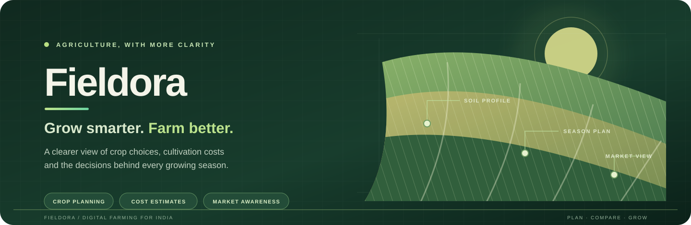
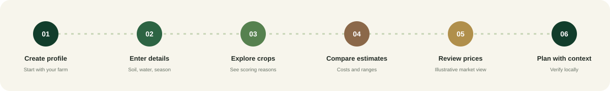

<div align="center">



<p>
  <a href="https://krishi-setu-gules.vercel.app/"></a>
  
  
  
</p>

<p><strong>Plan with context. Compare your options. Grow with more clarity.</strong></p>

</div>

---

## Explore Fieldora

<p align="center">
  <a href="#overview"></a>
  <a href="#field-tools"></a>
  <a href="#how-it-works"></a>
  <a href="#technology"></a>
  <a href="#quick-start"></a>
  <a href="#project-structure"></a>
  <a href="#screenshots"></a>
  <a href="#roadmap"></a>
</p>

<a id="overview"></a>
## 01 / Overview

**Fieldora** (formerly **KrishiSetu**) is an AgriTech web application concept built around the decisions farmers make throughout a growing season. It brings farm profiles, crop suitability comparisons, cultivation estimates and market-planning tools into one interface, with an experience shaped for the Indian farming context.

The goal is practical: make the assumptions behind a plan easier to see, compare and question — rather than presenting a recommendation as a guarantee.

| Built around the farm | Designed for decisions | Made to be approachable |
|:--|:--|:--|
| Capture location, land size, soil, irrigation and season. | Compare crop suitability, estimated costs and sale-versus-storage scenarios. | Responsive interface with English/Hindi controls and light/dark themes. |

<a id="field-tools"></a>
## 02 / Field tools

<table>
  <tr>
    <td width="50%" valign="top">
      <h3>🌾 Farm overview</h3>
      <p>A dashboard brings together a farm profile, season estimates, crop-plan snapshots and market-planning panels.</p>
    </td>
    <td width="50%" valign="top">
      <h3>🌱 Crop planner</h3>
      <p>A transparent, rule-based score compares crop assumptions against soil type, growing season, irrigation and limited location context. Recommendations include the reasons behind the score.</p>
    </td>
  </tr>
  <tr>
    <td width="50%" valign="top">
      <h3>₹ Cost calculator</h3>
      <p>Explore illustrative per-acre cultivation costs, yield ranges, estimated revenue and potential profit to understand how assumptions affect a plan.</p>
    </td>
    <td width="50%" valign="top">
      <h3>📊 Market snapshot</h3>
      <p>Review a sample price panel for Wheat, Soybean, Cotton and Maize. The current values are demonstration data, not a live mandi feed.</p>
    </td>
  </tr>
  <tr>
    <td width="50%" valign="top">
      <h3>🧺 Sell or store</h3>
      <p>Compare illustrative selling-now and storage scenarios, including estimated costs and potential differences. Future prices are assumptions, not forecasts.</p>
    </td>
    <td width="50%" valign="top">
      <h3>☀ Weather preview</h3>
      <p>The interface includes weather-style summary cards for the product experience. They are currently static demonstration values, not a connected forecast service.</p>
    </td>
  </tr>
  <tr>
    <td width="50%" valign="top">
      <h3>🌐 Language and theme</h3>
      <p>English/Hindi controls and light/dark theme preferences are available. Hindi coverage is currently partial.</p>
    </td>
    <td width="50%" valign="top">
      <h3>📱 Responsive workspace</h3>
      <p>Layouts and navigation adapt across desktop and smaller screens.</p>
    </td>
  </tr>
</table>

<a id="how-it-works"></a>
## 03 / How it works

The core flow moves from a farm profile to a set of planning comparisons.

<p align="center">
  
</p>

1. **Create a farm profile** — enter the farm location, land size and plot details.
2. **Describe growing conditions** — choose soil type, irrigation source and growing season.
3. **Explore crop suitability** — review ranked crops and the rules that influenced each score.
4. **Compare the economics** — adjust assumptions and inspect estimated costs, yield and profit ranges.
5. **Review market scenarios** — use the sample market panel and sell-or-store comparison as planning examples.
6. **Verify locally** — validate prices, weather and agronomic assumptions with trusted local sources before acting.

<a id="technology"></a>
## 04 / Technology

<p align="center">
  
  
  
  
  
  
</p>

| Technology | Role in Fieldora |
|:--|:--|
| React 18 | Component-based user interface and application state |
| Vite 6 | Local development server and production build |
| JavaScript (ES modules) | Application logic and crop-scoring rules |
| Recharts 2 | Dashboard data visualizations |
| Lucide React | Interface icons |
| Tailwind CSS 4 Vite plugin + project CSS | Styling build setup and application styling |

<a id="quick-start"></a>
## 05 / Quick start

### Prerequisites

- Node.js 18 or newer
- npm 9 or newer

### Run locally

The React/Vite application lives in the `Fieldora/` directory of this repository.

```bash
cd Fieldora
npm install
npm run dev
```

Open the local URL printed by Vite in your terminal.

### Production build

```bash
npm run build
npm run preview
```

<a id="project-structure"></a>
## 06 / Project structure

```text
repository-root/
├── README.md
└── Fieldora/
    ├── docs/
    │   ├── fieldora-readme-hero.svg
    │   ├── fieldora-landscape.svg
    │   └── fieldora-workflow.svg
    ├── public/
    │   ├── fieldora-logo.jpg
    │   ├── hero-field.svg
    │   └── krishisetu-logo.png
    ├── src/
    │   ├── cropScoring.js
    │   ├── main.jsx
    │   └── styles.css
    ├── index.html
    ├── package.json
    ├── package-lock.json
    └── vite.config.js
```

**Application flow:** `index.html` → `src/main.jsx` → `src/cropScoring.js` → browser-rendered Fieldora views.

Farm profiles, the prototype session and interface preferences are stored in the browser using `localStorage`. The current project does not include a server-side application or database.

<a id="screenshots"></a>
## 07 / Screenshots

Application screenshots have not been included in this README yet. Add genuine captures from the running application to `Fieldora/docs/screenshots/` and embed them here when available. Suggested captures:

- Landing page
- Farm overview dashboard
- Crop planner and scoring explanation
- Cost calculator
- Sell-or-store comparison

<a id="roadmap"></a>
## 08 / Roadmap

Potential next steps — **not implemented in the current prototype**:

- Connect verified mandi prices and historical market data.
- Integrate a real weather provider for farm-level forecasts.
- Add secure authentication and cloud-backed farm profiles.
- Expand complete Hindi translation and add regional languages.
- Add offline access and farm-data export.
- Improve crop assumptions with trusted, region-specific agronomic datasets.

---

<div align="center">

**Rooted in your land. Growing with your future.**

Made for farm planning in India · **Fieldora**

</div>

> **Agricultural disclaimer**  
> Crop suitability scores, cultivation costs, yield ranges, revenue, profitability, market values and weather-style summaries use illustrative or static demonstration assumptions in this prototype. They are not certified agricultural advice, verified live market quotes, or guaranteed forecasts. Sign-in is a client-side demonstration and does not verify identity. Confirm local conditions and current information with trusted agricultural experts and official sources before making farming or financial decisions.
